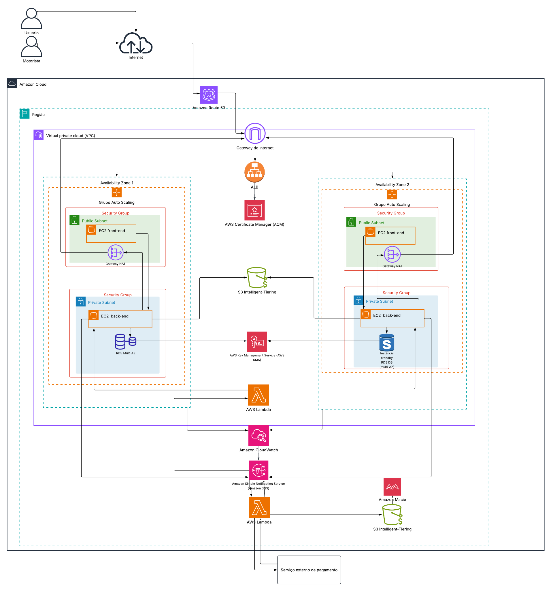

# 🚗 RotaFácil | Arquitetura AWS

### ☁️ Mobilidade urbana com segurança, escalabilidade e alta disponibilidade

O **RotaFácil** é um projeto acadêmico desenvolvido em equipe, com o objetivo de propor uma arquitetura em nuvem AWS para uma plataforma de mobilidade urbana que conecta passageiros e motoristas.

O projeto busca solucionar problemas de infraestrutura tradicional, como limitações de capacidade, ausência de redundância, armazenamento local de documentos e falta de monitoramento.

## 🌐 Demonstração do projeto

🔗 [Conheça o site do RotaFácil](https://vitorlinks-gdbvjfhd.manus.space/)

## 🏗️ Arquitetura da solução

A arquitetura proposta utiliza duas Zonas de Disponibilidade (AZs), com foco em escalabilidade, segurança e continuidade dos serviços.

## ☁️ Principais serviços AWS

| Serviço | Função no projeto |
|---|---|
| Amazon Route 53 | Gerenciamento de DNS |
| Amazon VPC | Isolamento e organização da rede |
| Amazon EC2 | Servidores da aplicação |
| Application Load Balancer | Distribuição do tráfego |
| Auto Scaling | Ajuste automático da capacidade |
| Amazon RDS Multi-AZ | Banco de dados relacional com alta disponibilidade |
| Amazon S3 | Armazenamento de fotos e documentos |
| S3 Intelligent-Tiering | Otimização dos custos de armazenamento |
| AWS Certificate Manager | Gerenciamento de certificados digitais |
| AWS KMS | Gerenciamento de chaves de criptografia |
| Amazon Macie | Identificação de dados sensíveis no S3 |
| Amazon CloudWatch | Monitoramento e alarmes |
| Amazon SNS | Notificações |
| AWS Lambda | Execução de funções orientadas a eventos |

## 🔐 Minha contribuição — Segurança AWS

Minha participação no projeto foi focada na proposta de soluções para proteger os dados pessoais de passageiros e motoristas.

Estudei e apresentei os seguintes serviços:

- **AWS Certificate Manager (ACM):** gerenciamento do certificado digital utilizado no ALB para estabelecer conexões HTTPS.
- **Amazon S3:** armazenamento de fotos e documentos dos usuários.
- **AWS KMS:** gerenciamento de chaves utilizadas na criptografia dos dados armazenados no S3 e no RDS.
- **Amazon Macie:** identificação de informações sensíveis armazenadas no S3.
- **S3 Intelligent-Tiering:** otimização dos custos de armazenamento.

O objetivo foi propor uma solução capaz de proteger os dados durante a transmissão e o armazenamento.

## 💡 Aprendizados

Durante o desenvolvimento do projeto, tive a oportunidade de aprofundar meus conhecimentos sobre:

- Segurança da informação em ambientes AWS.
- Criptografia de dados em trânsito e em repouso.
- Proteção de informações pessoais.
- Arquitetura em nuvem e alta disponibilidade.
- Comunicação técnica e trabalho em equipe.

## 👥 Trabalho em equipe

O projeto foi desenvolvido colaborativamente, com divisão de responsabilidades entre os integrantes, abrangendo infraestrutura, redes, escalabilidade, banco de dados, segurança, monitoramento e automação.

## 📌 Sobre o projeto

Este repositório documenta uma **proposta acadêmica de arquitetura AWS**. O diagrama representa os serviços planejados e não significa que toda a infraestrutura tenha sido implementada em produção.

---

**Ana Verduguez**  
Estudante de Análise e Desenvolvimento de Sistemas  
Interesses: Banco de Dados | Inteligência Artificial | Cloud Computing
